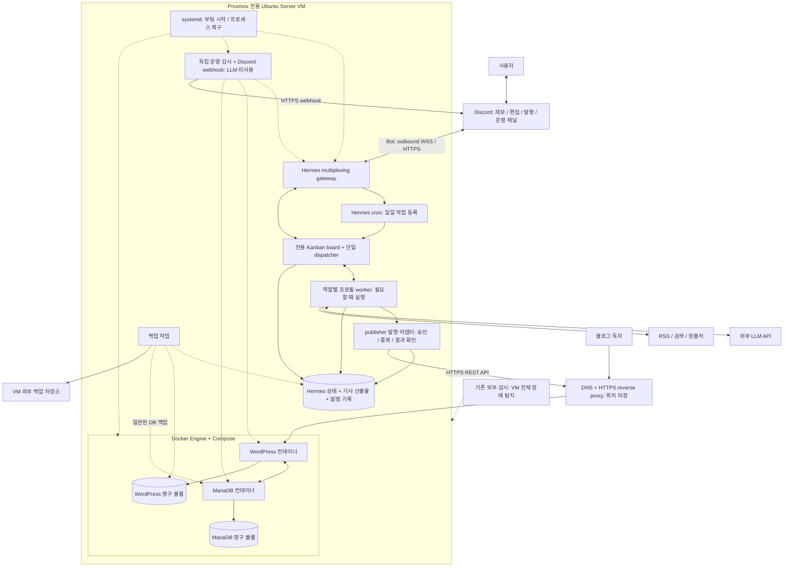
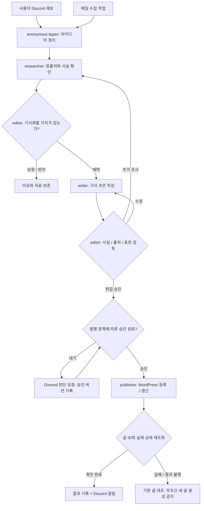

# The News — Requirements

> 버전: 0.1 · 상태: 검토용 초안
>
> 목표: scaffold를 만들기 전에 필요한 구성요소, 책임 경계, 실패 시 동작과 완료 조건을 정리합니다. 아래 **확정**은 사용자 요구사항이며, **추천**은 아직 승인되지 않은 설계안입니다. 이 문서는 설치·배포·공개 발행 승인이 아닙니다.

## 1. 목표와 기본 전제

Hermes 기반의 신문사가 매일 뉴스거리를 발견하고 조사·집필·편집하여 WordPress에 기사를 발행합니다. 사용자는 Discord로 제보하고 필요한 판단과 알림을 받습니다.

| 구분 | 요구사항 |
| --- | --- |
| 확정 | Proxmox의 전용 Ubuntu Server VM에서 운영합니다. |
| 확정 | Hermes 실행 환경은 서비스 관리자가 부팅 시 시작하고, 예기치 않은 종료 후 복구해야 합니다. |
| 확정 | WordPress와 MariaDB를 **서로 다른 Docker 컨테이너**로 운영합니다. |
| 확정 | 신문사 역할은 `anonymous tipper`, `researcher`, `writer`, `editor`, `publisher`입니다. |
| 확정 | Discord는 사용자 제보·키워드 입력과 기사 후보군·운영 문제 알림의 창구입니다. |
| 추천 | Ubuntu의 **systemd**를 사용합니다. `systemctl`은 이를 제어하는 명령이며, 별도 supervisord를 중복 도입하지 않습니다. |
| 추천 | 첫 버전은 외부 LLM API를 사용합니다. 로컬 모델·GPU 서빙은 기본 범위에 넣지 않습니다. |
| 미정 | 주제, 언어, 일일 기사 수, 실행 시각·시간대, 모델·예산, 공개 도메인, 발행 승인 정책과 백업 목적지입니다. |

범위 밖: 이번 단계의 제품 코드, Compose 파일, systemd unit, 실제 프로필 생성과 배포. 고가용성·다중 VM 분산 실행도 초기 목표가 아닙니다. 기본 역할과 기사 품질 원칙은 [AGENTS.md](AGENTS.md)를 따릅니다.

## 2. 현실적인 최소 구성

**추가로 필요한 것은 또 다른 거대한 서버가 아니라, 업무 상태·발행 안전장치·데이터 보존·운영 감시입니다.**

| 구성요소 | 필요성 | 추천 배치와 책임 |
| --- | --- | --- |
| Hermes gateway + 역할별 프로필 | 필수 | VM 호스트의 전용 비관리자 계정에서 실행합니다. gateway는 Discord와 프로필 실행을 연결합니다. |
| Hermes Kanban + dispatcher | 필수 기능, 내장 기능 추천 | 신문사 전용 board로 담당 업무·의존 관계·검토·재시도 기록을 보존합니다. board당 dispatcher 소유자를 하나로 정합니다. |
| 일일 실행 스케줄러 | 필수 기능, Hermes cron 추천 | 매일 작업을 등록합니다. 긴 조사·집필 전체를 cron 한 번에 몰아넣기보다 Kanban 작업으로 넘깁니다. |
| WordPress | 필수 | Docker Compose의 독립 서비스. 초기에는 웹서버가 포함된 Apache 이미지 계열을 검토하여 별도 PHP-FPM 서버를 늘리지 않습니다. |
| MariaDB | 필수 | Compose의 독립 서비스와 영구 볼륨. WordPress 데이터베이스만 담당합니다. |
| DNS + HTTPS 진입점 | 운영 전 필수 | 기존 홈랩 reverse proxy를 우선 재사용합니다. 없다면 Caddy 등을 추가합니다. 설치 위치와 도메인은 미정입니다. |
| 뉴스 수집 수단 + LLM 공급자 | 필수 외부 의존성 | RSS·원문·검색으로 자료를 확보하고 역할별 모델 호출을 수행합니다. 공급자와 수집 대상은 미정입니다. |
| 발행 어댑터 | 필수 기능 | publisher가 호출하는 작은 연동 코드로 승인본 확인·REST API 호출·중복 방지·결과 재조회를 처리합니다. 초기에는 독립 API 서버가 필요하지 않습니다. |
| 영구 작업 저장소 | 필수 | Hermes 상태와 기사 산출물을 보존합니다. MariaDB를 Hermes 상태 저장소로 대체하지 않습니다. |
| 로그 + 독립 운영 감시 | 운영 전 필수 | journald·컨테이너 로그와 systemd timer 기반의 비LLM 감시를 사용합니다. gateway가 죽어도 운영 알림을 시도할 수 있어야 합니다. |
| 백업 + 복구 검증 | 운영 전 필수 | DB·WordPress 파일·Hermes 상태를 VM 밖의 별도 목적지에 보관하고 복구를 시험합니다. |

초기에는 Redis, Celery, RabbitMQ, 별도 PostgreSQL, FastAPI 서버, Kubernetes, 자체 관리자 UI를 도입하지 않습니다. 기존 구성으로 충족하지 못하는 요구가 확인되면 추가합니다.

## 3. 구성요소 연결도

실선은 데이터·업무 전달, 점선은 관리·감시·백업 관계입니다. HTTPS 진입점과 백업 목적지는 기존 홈랩 서비스를 재사용할 수 있습니다. 아래 연결은 논리 구조이며 IP·포트 바인딩이나 방화벽 설정을 확정한 그림이 아닙니다.

### 역할 수와 상시 프로세스 수는 다릅니다

다섯 역할이 있다고 gateway를 다섯 개 상시 실행할 필요는 없습니다. systemd가 gateway 하나를 관리하고, dispatcher가 업무가 있을 때 해당 프로필의 worker를 실행하는 구성을 추천합니다. 유휴 worker의 정상 종료는 장애가 아닙니다.

## 4. 서비스 수명주기와 장애 복구

### R-01. 로그인 없이 기동하고, 종료와 정지를 구분해야 합니다

- Hermes gateway와 Docker Engine은 VM 부팅 후 SSH 로그인 없이 시작되어야 합니다. Proxmox 호스트 재부팅 후에도 서비스 복구가 필요하면 VM 자동 시작도 확인합니다.
- Hermes는 공식 서비스 설치 흐름을 우선 사용하고 생성된 unit을 검토합니다. system service는 전용 비관리자 `User`로 실행하는 방식을 추천합니다. user service를 사용하면 로그아웃 후·재부팅 후 실행 조건도 검증합니다.
- gateway의 예기치 않은 종료는 지연을 둔 재시작으로 복구합니다. 정상 종료 코드까지 복구할지는 명시하고, 운영자의 의도적인 정지는 존중합니다.
- 재시작 횟수·시간 제한과 초과 시 알림을 두어 잘못된 인증정보나 손상된 설정으로 무한 재시작하지 않게 합니다.
- 역할별 gateway를 각각 만들어 같은 bot token을 중복 연결하지 않습니다. 프로필 수, gateway 수, Discord bot 수는 별개의 선택입니다. [S1]

### R-02. 컨테이너 종료와 서비스 불건강을 별도로 처리해야 합니다

- WordPress와 MariaDB에는 Docker restart policy를 두고, 프로세스 재시작의 주체는 Docker로 통일합니다. systemd와 Docker가 같은 컨테이너를 서로 재시작하는 이중 감독은 피합니다. [S5]
- 컨테이너 재생성은 Compose로 관리합니다. 컨테이너가 삭제된 상황까지 restart policy가 자동 복원한다고 가정하지 않습니다.
- 초기 기동 시 DB 준비 상태를 확인한 후 WordPress를 시작합니다. 단순 실행 순서와 실제 요청 처리 가능 상태는 다릅니다. [S6, S7]
- healthcheck의 `unhealthy` 표시는 Docker 단독 환경에서 자동 재시작을 보장하지 않습니다. 감시·알림·제한된 복구 정책을 별도로 정합니다.
- DB 일시 장애 중에는 발행을 보류하고 복구 후 제한적으로 재시도합니다. gateway 전체를 WordPress 장애와 함께 중단시킬 필요는 없습니다.

### R-03. 실행 중단 후 업무를 안전하게 이어가야 합니다

- 신문사 전용 board, 프로필 작업 경로, dispatcher 소유자를 명시합니다. 개발용 board와 섞지 않습니다.
- 기사 식별자와 실행 회차를 기준으로 일일 작업 중복 등록을 막고, 프로필 실행 시간·동시 실행 수·실패 재시도 수를 제한합니다.
- 완료 산출물과 중간 체크포인트를 보존하고, 재시작 시 완료·진행·실패·결과 불명 상태를 구분합니다. 임의의 실행 중 명령이나 모델의 사고 과정이 그대로 재개된다고 가정하지 않습니다.
- heartbeat가 끊긴 worker의 재배정은 Kanban의 수명주기를 사용합니다. OS 재시작만으로 업무 완료나 외부 발행 성공을 판단하지 않습니다. [S2]
- VM 정지 중 놓친 일일 실행을 건너뛸지, 당일 한 번 보충할지 정합니다. 과거 실행을 한꺼번에 재생하여 기사와 비용이 폭증하지 않게 합니다.

## 5. 신문사 업무 요구사항

### R-04. 제보부터 편집까지 근거와 버전을 전달해야 합니다

- 각 전달물에는 기사 ID, 원출처 URL, 확인 시점, 핵심 사실, 미확인 사항, 산출물 버전과 다음 담당 업무를 남깁니다.
- 검색 결과 요약만으로 핵심 사실을 확정하지 않습니다. 가능한 원출처를 확인하고, 확인할 수 없으면 보류하거나 한계를 표시합니다.
- 취재·집필 산출물은 영구 첨부물 또는 보존되는 작업 디렉터리에 둡니다. 완료 시 정리되는 scratch workspace만을 보관소로 사용하지 않습니다. [S2]
- 일일 발행 목표보다 사실성과 품질을 우선합니다. 채택할 자료가 없으면 발행하지 않고 사유를 알릴 수 있어야 합니다.
- 수정·보완 반복 횟수와 조사 범위를 제한하고, 한도를 넘으면 사용자 판단을 요청합니다.

### R-05. 공개 발행에는 명시적인 승인과 중복 방지가 필요합니다

- 발행 정책이 정해지기 전에는 공개 발행을 비활성화합니다. 첫 검증은 테스트 사이트 또는 비공개 초안으로 수행합니다.
- 사용자 승인 방식과 editor 승인 후 자동 발행 방식 중 하나를 선택합니다. 승인자·기사 ID·승인본 버전을 기록하고, 승인 후 본문이 바뀌면 재승인합니다.
- 발행 어댑터가 승인 상태와 대상 버전을 확인한 뒤 REST API를 호출합니다. 모델에게 승인 여부를 기억하라고 지시하는 것만으로 완료하지 않습니다.
- 기사 ID와 WordPress 글 ID의 대응, 시도 상태, 승인 버전과 최종 URL을 보존합니다. 재시도는 기사별 직렬화하여 동시에 두 번 생성하지 않게 합니다.
- 최초 생성은 초안으로 수행하고 글 ID를 확보한 뒤 같은 글을 갱신하는 방식을 우선 검토합니다. 생성 응답이 유실되면 사전 기록한 식별정보로 대조하고, 판별할 수 없으면 보류합니다. WordPress가 임의의 idempotency key를 자동 처리한다고 가정하지 않습니다.
- 발행 후 인증된 재조회로 저장된 내용·상태를 확인하고, 공개 발행이라면 독자용 URL도 확인합니다. 처리 결과와 알림 전송 결과는 별도로 기록합니다.
- 발행된 기사의 오보·권리 문제에 대해 수정, 비공개 전환 또는 철회할 운영 절차가 있어야 합니다.

### R-06. 수집 수단과 모델 비용을 운영 가능하게 제한해야 합니다

- 필수 외부 의존성은 LLM 공급자와 뉴스 수집 수단입니다. RSS·직접 URL·검색 중 최소 하나의 실제 입력 경로를 검증하고, 검색이 유료 API라면 별도 예산에 포함합니다.
- 역할별 모델, 동시 실행 수, 일일 작업 수, 최대 실행 시간과 수정 횟수를 정합니다. 계정 인증 갱신과 사용 한도 오류도 감시합니다.
- 공급자가 제공하는 잔여 한도와 자체 토큰·비용 추정치를 구분합니다. 추정만 가능한 경우 정확한 잔액이나 즉시 강제되는 비용 상한처럼 표시하지 않습니다.
- 예산 기준 초과 시 신규 작업을 중단·보류하고 알립니다. 모델이 임의로 더 비싼 모델이나 다른 유료 공급자로 전환하지 않게 합니다.
- 일일 작업의 시간대는 명시적으로 설정하고 실행 기록의 시간 기준을 일관되게 유지합니다. [S3]

## 6. 접근 경계와 알림

### R-07. 연결은 필요한 경로로 제한해야 합니다

| 출발지 → 목적지 | 허용 목적과 경계 |
| --- | --- |
| 사용자 → Discord → gateway | 허용된 사용자·서버·채널의 제보와 판단만 수신합니다. 기사별 thread와 실제 작업 ID를 연결합니다. |
| VM → Discord | gateway 연결과 메시지 전송은 outbound WSS/HTTPS를 사용합니다. Discord 수신만을 위해 VM의 공용 inbound API를 열지 않습니다. [S4] |
| 독자 → HTTPS proxy → WordPress | HTTPS 진입점을 통해 블로그를 제공합니다. 공개 여부·도메인·proxy 위치를 먼저 결정합니다. |
| publisher → HTTPS proxy → WordPress REST API | 전용 서비스 계정으로 인증합니다. 내부에서 같은 주소에 접근할 DNS·라우팅도 검증하고 TLS 검증을 끄지 않습니다. [S8] |
| WordPress → MariaDB | Compose 내부 DB 네트워크로만 연결합니다. MariaDB의 TCP 3306은 VM·LAN·인터넷에 publish하지 않습니다. |
| 관리자 → VM / 관리 화면 | 기존 관리망 또는 VPN을 사용합니다. Hermes 관리 API와 Docker socket을 인터넷에 노출하지 않습니다. |
| VM → LLM / 뉴스 원출처 / DNS / 시간 동기화 | 수집·추론과 안정적인 인증에 필요한 외부 의존성을 확인합니다. |

WordPress의 호스트 포트가 필요하면 같은 VM의 proxy에는 loopback, 외부 proxy에는 지정된 내부 경로로 제한합니다. Docker 포트 공개가 호스트 방화벽과 어떻게 상호작용하는지도 실제 접근 테스트로 확인합니다. 기존 홈랩 VLAN·VPN 구성을 임의로 변경하지 않습니다.

### R-08. 비밀정보와 실행 권한을 분리해야 합니다

- Hermes·LLM·Discord·WordPress·MariaDB 자격증명은 각각 관리합니다. 비밀 값은 Git, 기사, 로그, 카드와 Discord 알림에 남기지 않습니다.
- WordPress API는 관리자 계정 대신 필요한 권한만 가진 서비스 계정과 Application Password를 사용합니다. Application Password 자체가 권한을 세분화하는 것은 아니며 계정 권한이 기준입니다. [S8]
- Hermes에는 root, 무제한 sudo, Docker socket 접근 권한을 부여하지 않습니다. DB 데이터 볼륨과 운영용 비밀 파일도 직접 공유하지 않습니다.
- publisher만 발행을 요청하도록 역할과 도구를 제한하되, **같은 OS 계정으로 실행되는 프로필은 보안 격리 경계가 아님**을 명시합니다. 강제 격리가 필요하면 별도 계정·sandbox 또는 보호된 발행 서비스를 설계해야 하며, 현 구조만으로 publisher 외 접근 차단을 보장하지 않습니다.
- 외부 기사와 제보는 신뢰하지 않는 입력으로 처리합니다. 그 안의 지시로 명령 실행, 비밀정보 조회, 승인 우회 또는 임의 내부 URL 접근을 허용하지 않습니다.

### R-09. 편집 알림과 운영 알림을 분리해야 합니다

| 채널 예시 | 내용 |
| --- | --- |
| `#news-tips` | 제보와 키워드 입력 |
| `#news-desk` | 기사 후보, 검토 결과, 사용자 승인 요청 |
| `#news-published` | 발행·수정 결과와 URL |
| `#news-ops` | 서비스 장애, 작업 정체, 인증·예산 문제, 백업 실패 |

- Discord bot 하나와 gateway의 프로필 라우팅으로 시작하는 것을 추천합니다. bot token의 중복 poller를 만들지 않으며, 작업 결과 알림의 발송 프로필·자격증명·목적지 채널도 별도로 검증합니다. [S1, S2]
- 운영 감시는 Hermes gateway 밖에서 실행하고, 알림은 LLM 호출 없이 Discord webhook 등으로 전송합니다. gateway·모델 인증이 고장 나도 경보 경로는 남아 있어야 합니다.
- 프로세스 생존, Discord 연결, 마지막 일일 실행, 오래 정체된 작업, WordPress 응답, DB 상태, 디스크 여유와 백업 결과를 구분하여 감시합니다.
- 경보는 최초 장애·상태 변화·복구 중심으로 묶고 전송 속도를 제한합니다. Discord 장애 중에는 로컬 실패 기록을 보존하고 복구 시 요약합니다.
- **같은 VM의 감시로 VM 전체 정지나 홈랩 인터넷 단절을 알릴 수는 없습니다.** 전체 장애 탐지가 필요하면 기존 외부 감시나 VM 밖의 감시 지점을 연결합니다. 별도 감시 제품의 신규 도입은 미정입니다.

## 7. 영구 저장소, 백업과 유지보수

### R-10. 컨테이너와 worker를 교체해도 데이터가 남아야 합니다

| 데이터 | 보존 원칙 |
| --- | --- |
| WordPress DB | MariaDB 전용 영구 볼륨. 실행 중 데이터 디렉터리를 단순 복사하는 방식 대신 일관된 DB 백업을 사용합니다. |
| WordPress 파일 | 업로드와 사용 중인 테마·플러그인 등 복구에 필요한 파일·설정을 보존합니다. [S9] |
| Hermes 상태 | 프로필 설정·메모리·세션, cron, Kanban DB·첨부물과 실행 기록을 보존합니다. 활성 SQLite는 일관된 백업 또는 정지 후 백업을 사용합니다. |
| 기사 산출물·발행 기록 | 취재 자료, 초안, 승인본, 글 ID 대응과 결과 불명 기록을 영구 저장합니다. |
| 자격증명 | 별도 암호화 백업 또는 재발급·복구 수단을 마련합니다. 일반 산출물과 섞지 않습니다. |
| 로그 | journald·Docker 로그의 용량·보존 기간을 제한합니다. 비밀정보와 제보 원문을 무제한 보관하지 않습니다. |

Hermes의 공유 SQLite board와 상태는 VM의 로컬 영구 디스크에 둡니다. 여러 머신이 네트워크 파일시스템의 같은 SQLite를 직접 쓰는 구조는 초기 범위에서 제외합니다.

### R-11. 백업은 복구 가능한 별도 사본이어야 합니다

- VM 밖의 목적지에 보관하고, Proxmox 호스트·원본 디스크 손실까지 보호할지 확인합니다. 같은 물리 디스크의 사본이나 snapshot만으로 독립 백업을 대체하지 않습니다.
- 백업은 DB·파일·Hermes 상태의 일관성을 고려하고, 복구 직후 발행 기록과 WordPress를 대조합니다. 테스트 복구 환경에서는 cron·Discord 수신·공개 발행을 먼저 비활성화하여 중복 실행을 막습니다.
- 허용 데이터 손실량인 RPO와 복구 시간 목표인 RTO, 백업 주기·보존 개수·목적지를 운영 전 확정합니다. 일일 백업은 출발점 후보일 뿐 확정된 복구 목표가 아닙니다.
- 실제 백업에서 테스트 환경으로 복원하여 기사·이미지·작업 상태와 발행 기록을 확인합니다. VM 백업과 애플리케이션 백업의 책임도 구분합니다.

### R-12. 업데이트와 자원 부족이 전체 운영을 무너뜨리지 않아야 합니다

- Ubuntu LTS, Hermes 릴리스, WordPress·MariaDB 이미지와 플러그인의 검증된 버전을 기록하고 호환 조합을 고정합니다. 운영 이미지를 검토 없이 `latest`로 갱신하지 않습니다.
- 업데이트 전 백업과 복원 절차를 확인합니다. 특히 DB 업그레이드는 이전 이미지로 되돌리기만 하면 복구된다고 가정하지 않습니다.
- 프로필 동시 실행과 메모리·디스크 사용을 제한하여 과도한 수집이나 브라우저 작업이 DB와 블로그까지 고갈시키지 않게 합니다.
- VM vCPU·RAM·디스크는 아직 산정하지 않습니다. Proxmox 실제 여유 자원, 기사량, 동시 worker 수, 브라우저 필요 여부와 저장 기간을 확인한 뒤 산정합니다.
- VM·호스트 장애 시 전체 서비스가 멈추는 단일 장애 지점은 초기 구성의 허용 제약입니다. 자동 재시작은 고가용성과 다릅니다.

## 8. 운영 가능 판정 — 구현 후 확인할 완료 조건

아래 항목은 **앞으로 수행할 검증**이며, 지금 통과했다는 뜻이 아닙니다.

| 검증 | 통과 조건 | 관련 요구사항 |
| --- | --- | --- |
| 무인 부팅 | VM 재부팅·SSH 미접속 상태에서 gateway, Docker와 컨테이너가 기동하고 Discord 제보를 처리합니다. | R-01, R-02 |
| 비정상 종료 | gateway와 개별 컨테이너 종료 후 설정된 시간 내 복구합니다. 정상 worker 종료·의도적 정지는 장애 재시작과 구분됩니다. | R-01, R-02 |
| 불건강·DB 장애 | 프로세스가 살아 있어도 불건강 상태를 탐지하고 알립니다. DB 장애 중 발행은 보류되며 복구 후 중복 없이 처리됩니다. | R-02, R-09 |
| 작업 재개 | 조사·집필 도중 재시작해도 자료와 업무 상태가 남습니다. 놓친 스케줄을 선택한 정책대로 처리합니다. | R-03, R-04 |
| 제보·권한 | 허용된 Discord 사용자의 제보만 작업화하고 다른 사용자의 발행 승인 요청은 거부합니다. | R-07, R-09 |
| 승인 차단 | 미승인본과 승인 후 변경된 본문은 공개 발행되지 않습니다. | R-05 |
| 결과 불명·중복 | 발행 응답 유실과 같은 작업의 재실행을 재현해도 새 글을 무조건 만들지 않습니다. 기존 글을 대조하거나 안전하게 보류합니다. | R-05 |
| 실제 발행 결과 | 테스트 글의 ID·내용·상태를 재조회하고, 허용된 공개 테스트에서는 독자 URL과 Discord 결과 알림을 확인합니다. | R-05, R-09 |
| 예산·인증 실패 | 추론을 사용할 수 없는 상황에서도 신규 작업 보류와 비LLM 운영 알림이 동작합니다. | R-06, R-09 |
| 접근 경계 | DB·Hermes 관리 API·Docker socket이 외부에 노출되지 않고, 발행 계정은 관리 작업에 필요한 과도한 권한을 갖지 않습니다. | R-07, R-08 |
| 데이터 보존 | 컨테이너 재생성 후 기사·이미지·DB·Hermes 업무 상태가 남습니다. | R-10 |
| 복구 | 별도 백업에서 비공개 테스트 환경으로 복원하고 정한 RPO·RTO 충족 여부와 중복 발행 차단을 확인합니다. | R-11 |
| 자원·갱신 | 합의한 일일 기사량과 동시성으로 실행하여 자원 여유·로그 제한·업데이트 복구 절차를 확인합니다. | R-12 |

## 9. scaffold 전에 결정할 사항과 작업 순서

### 사용자 판단이 필요한 항목

1. **발행 권한:** 매번 사용자 승인인가요, editor 승인 후 자동 발행인가요? 별도 OS 수준 발행 격리가 필요한지도 결정합니다.
2. **편집 기준:** 다룰 주제·언어, 일일 후보·기사 수, 자료가 부족한 날의 처리, 제보 외 자동 수집 범위는 무엇인가요?
3. **모델과 예산:** 공급자·역할별 모델·일일 또는 월간 기준, 한도 도달 시 중단 기준을 정합니다.
4. **운영 접점:** Discord 서버·채널·허용 사용자와 일일 실행 시각·시간대를 정합니다.
5. **공개 접속:** 블로그 도메인·공개 범위·기존 reverse proxy 재사용 여부를 정합니다.
6. **복구 목표와 자원:** 백업 목적지·RPO·RTO, 외부 감시 연결 여부와 Proxmox 가용 자원을 확인합니다.

### 승인 후 추천 순서

1. 위 결정과 이 문서의 승인 버전을 기록하고, VM·도메인·자격증명·백업 목적지의 준비 여부를 확인합니다.
2. 최소 scaffold를 작성합니다. 대상은 Compose, 서비스 설치·검증 절차, 비밀 값 없는 설정 예시와 영구 저장 경로입니다.
3. WordPress·MariaDB·HTTPS·데이터 보존을 먼저 검증하고 Hermes gateway·프로필·board·Discord를 연결합니다.
4. 기사 한 건을 비공개로 끝까지 처리하여 승인·결과 재조회·중복 방지를 확인합니다.
5. 장애·예산·백업 복구 검증 후, 승인된 범위에서 일일 스케줄과 공개 발행을 활성화합니다.

## 10. 근거와 검증 한계

- [S1: Hermes 다중 프로필 gateway](https://hermes-agent.nousresearch.com/docs/user-guide/multi-profile-gateways)
- [S2: Hermes Kanban](https://hermes-agent.nousresearch.com/docs/user-guide/features/kanban)
- [S3: Hermes cron](https://hermes-agent.nousresearch.com/docs/user-guide/features/cron)
- [S4: Hermes Discord gateway](https://hermes-agent.nousresearch.com/docs/user-guide/messaging/discord)
- [S5: Docker 자동 재시작 정책](https://docs.docker.com/engine/containers/start-containers-automatically/)
- [S6: Compose 기동 순서와 준비 상태](https://docs.docker.com/compose/how-tos/startup-order/)
- [S7: MariaDB 공식 이미지 healthcheck](https://mariadb.com/docs/server/server-management/automated-mariadb-deployment-and-administration/docker-and-mariadb/using-healthcheck-sh)
- [S8: WordPress REST API 인증](https://developer.wordpress.org/rest-api/using-the-rest-api/authentication/)
- [S9: Docker 영구 볼륨](https://docs.docker.com/engine/storage/volumes/)
- [S10: systemd 서비스 수명주기](https://www.freedesktop.org/software/systemd/man/latest/systemd.service.html)

공식 문서로 기능과 책임 경계를 확인한 요구사항 초안입니다. 실제 Ubuntu VM·Proxmox·Discord·WordPress에 접속하여 운영 동작을 검증하지는 않았습니다. Context7 연결은 현재 도구 목록에 없어, 이번에는 공식 문서를 직접 열람했습니다. 구현 단계의 라이브러리·API·설정 상세 검증에는 Context7 연결이 필요하며, 서비스 옵션은 실제 설치 버전의 지원 여부도 확인해야 합니다.
